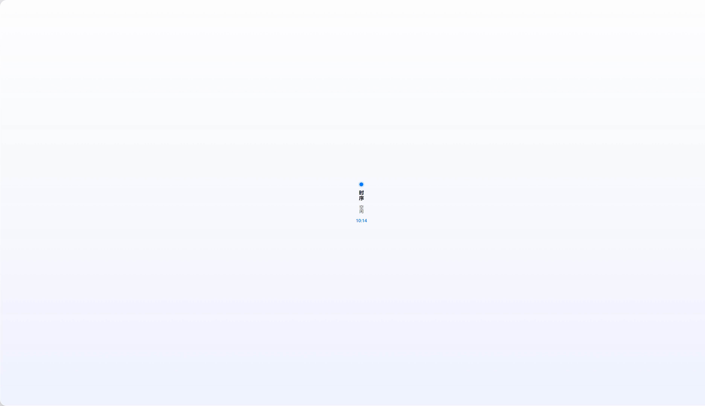
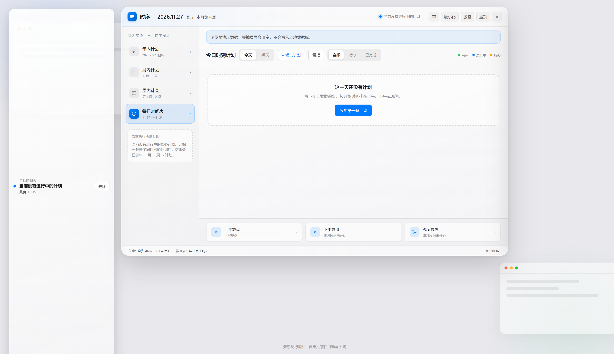
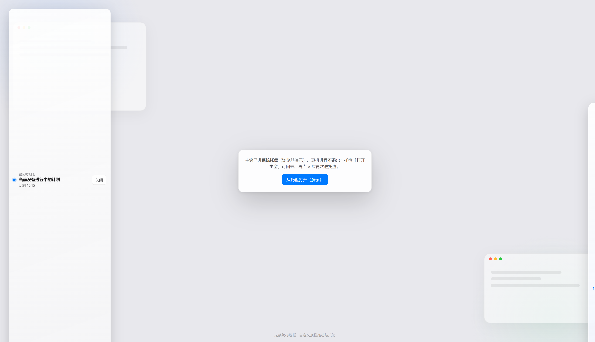

# 汇报

- 角色：前端
- 分支：`fe/fix-pin-capsule`
- 契约版本：0.3.3

## 给人看的产出

### 这一阶段交出了什么

真机副窗如果标签是「置顶 / 胶囊」，首屏只画对应小界面，不再先闪一整页主壳。点顶栏「置顶」「胶囊」成功或失败都会有短提示；胶囊必须先打开成功，再藏主窗，避免「主窗没了、胶囊也没有」。

### 打开窗口能看到什么

- 副窗角色为置顶时：横条「置顶时刻表」+ 当前计划/空闲 +「关闭」，不是左侧导航那套主壳。
- 副窗角色为胶囊时：竖条「时序 / 状态 / 时间」，点一下用来回主窗。
- 主窗顶栏仍是「最小化 / 胶囊 / 置顶 / ×」。

### 点哪里、会发生什么

1. 点「置顶」→ 调用打开置顶窗；成功提示「已打开置顶小窗」，失败提示错误原因（不再假装成功）。
2. 点「胶囊」→ 先打开胶囊；成功后再藏主窗，提示「胶囊已显示，主窗已进托盘」。胶囊没开成则主窗不藏，并提示失败。
3. 副窗带 `?window=pin|capsule` 或系统窗标签为 pin/capsule 时，首屏直接是小窗界面。

### 还没做什么

- 不改后端创建/几何/权限（见 `be/fix-pin-capsule`）；本刀不把浏览器浮层当成修好。
- 不做提醒、导出、开机自启。

### 截图

用 `?window=` 证明首屏角色路由（不是主壳里的演示浮层）。真机独立副窗是否弹出，依赖后端分支合入后由组织者/协作者复验。


打开带 `?window=pin` 的页：只见置顶横条与「关闭」，没有整页主壳。



打开带 `?window=capsule` 的页：只见竖条胶囊（时序 / 空闲 / 时间）。



主窗点「置顶」后浏览器会出演示浮层；真机应以独立系统窗为准。



点「胶囊」后：胶囊先出，主窗再进托盘演示态。

## 改了哪些文件

- `src/App.tsx`：角色未定时不画 AppShell；挂 `data-window-role`
- `src/lib/windowRole.ts`、`src/lib/windowRole.test.ts`：query + label 双保险；Tauri 下推迟主壳
- `src/api/window.ts`：真机 show 后核对副窗可见并再顶一次置顶/聚焦
- `src/components/shell/AppShell.tsx`：置顶/胶囊成功失败 toast；胶囊先 show 再藏主窗
- `src/components/windows/PinWindow.module.css`、`CapsuleWindow.module.css`、`src/styles.css`：副窗几何与透明底
- `docs/reports/fix-pin-capsule/`：本汇报与截图

未手改 `src/bindings.ts`。未改 `src-tauri/`。

## 运行的命令和最后几行输出

```text
pnpm typecheck
# （通过）

pnpm lint
# All matched files use Prettier code style!

pnpm test
# Test Files  10 passed (10)
# Tests  29 passed (29)

pnpm ownership
# ownership: fe 的 0 个文件都在允许范围内
```

## 没做完的部分

真机点「置顶」仍可能看不见独立小窗——创建、URL `?window=`、横条默认几何在后端任务包。请组织者按 **后端 → 前端** 合入后，在真机开发版再点一次验收。

## 需要人决定的问题

无。请先合 `be/fix-pin-capsule`，再合本分支做真机复验。
