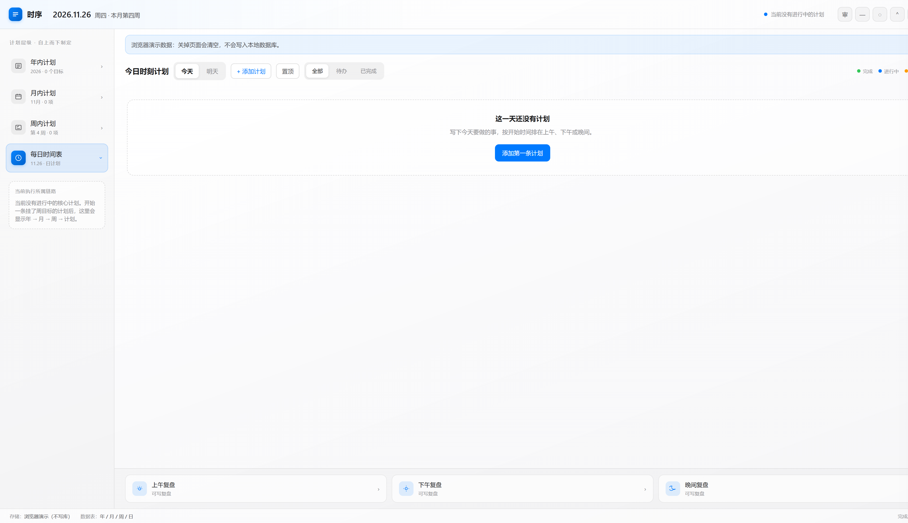
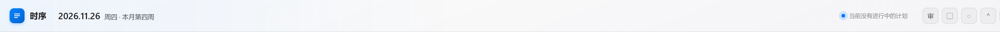
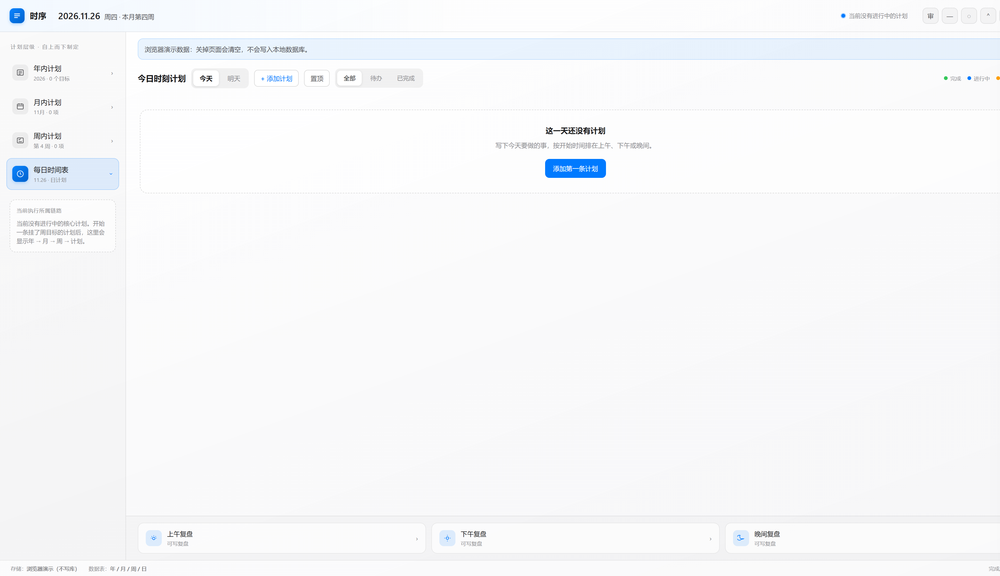

# 汇报

- 角色：前端
- 分支：`fe/fix-window-layout`
- 契约版本：0.3.1

## 给人看的产出

### 这一阶段交出了什么

修了真机折叠后「整窗空白壳」：折叠时只剩顶栏（矮条），不再是内容卸掉却仍撑满窗口的空白大壳。再点展开，左轨和日视图还在。真机继续没有假桌面。托盘隐藏时前端不再把不可见窗口的废尺寸写回布局（仍需后端一起拒绝坏档）。

### 打开窗口能看到什么

- 展开：顶栏 + 左轨 + 日视图 + 底栏，铺满真机窗口（无假桌面）
- 折叠：只看见顶栏矮条；按钮变成「展开」（▢）
- 再展开：左轨、今日计划区、复盘底栏恢复

### 点哪里、会发生什么

1. 顶栏「—」→ 折叠：壳高变顶栏高度；真机还会把窗口缩到约 60px 高，并记住展开前的尺寸。  
2. 顶栏「▢」→ 展开：恢复展开尺寸与完整界面。  
3. 关进托盘后：前端 `onMoved` / `onResized` 若窗口不可见则不写盘；折叠态只更新位置，不把矮高度当成下次展开高度。

### 还没做什么

- 提醒、导出、开机自启、评分、云同步
- 后端对坏档的校验 / 启动回退（见下方依赖）

### 截图

说明：下列截图在浏览器里用 `data-shell="native"` 模拟真机铺满样式（无假桌面）。折叠图只截顶栏矮条，避免浏览器视口仍很高造成的误会；真机折叠时窗口本身会被缩到顶栏高度。

展开：能看到左轨和日视图。



折叠：只剩顶栏，不是整窗空白壳；按钮为「展开」。



再展开：左轨与日视图恢复。



## 改了哪些文件

- `src/components/shell/AppShell.tsx`：折叠不卸掉内容（hidden）；真机折叠/展开调窗口高度；持久化跳过不可见窗与坏几何；折叠时保留展开尺寸
- `src/components/shell/AppShell.module.css`：去掉 native 折叠 `height:100%`；折叠外层不再撑满
- `src/styles.css`：native 折叠时根节点高度随顶栏
- `src/lib/windowFrame.ts`、`windowFrame.test.ts`：展开几何校验
- `docs/reports/fix-window-layout/前端.md` 与截图

未手改 `src/bindings.ts`。未改 `package.json`。

## 运行的命令和最后几行输出

```text
pnpm typecheck
# 通过

pnpm lint
# All matched files use Prettier code style!

pnpm test
# Test Files  9 passed (9)
# Tests  24 passed (24)

pnpm ownership
# ownership: fe 的 N 个文件都在允许范围内
```

## 没做完的部分

无前端范围内未完成项。真机杀进程后再开的坏档回退依赖后端 `be/fix-window-layout`。

## 需要人决定的问题

无。

### 需后端配合（写进汇报）

1. `hide_main_to_tray` / 折叠时不要把隐藏后的废坐标、矮高度覆盖「展开几何」；`mainCollapsed` 与展开 `main` 尺寸应能同时保留。  
2. 启动读到过小 / 屏外布局应回退默认，不要开出几十像素高的窗。  
3. 前端已：不可见不写盘、折叠不写矮高为展开高、真机折叠时自行 `setSize`；与后端校验叠加更稳。
