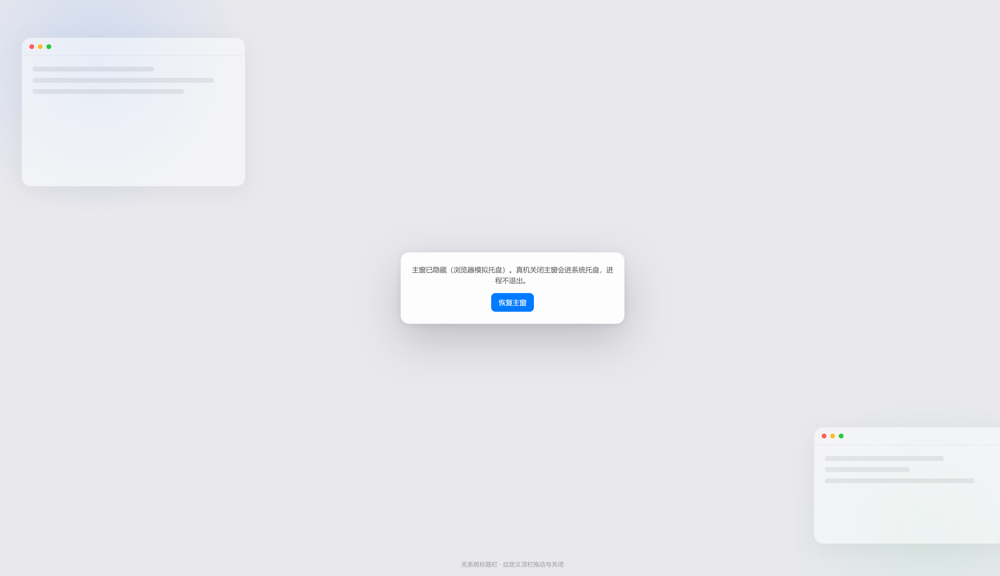

# 汇报

- 角色：前端
- 分支：`fe/hotfix-close-tray-repeat`
- 契约版本：0.3.2

## 给人看的产出

### 这一阶段交出了什么

修好了「× 关一次进托盘，从托盘打开后再点 × 可能没反应」：现在每次点 ×（以及系统关闭拦截）都会再次隐藏主窗进托盘，进程不退出。

### 打开窗口能看到什么

顶栏 × 仍是「关闭到托盘」，不是退出。行为与改前一致，只是第二次、第三次也可靠。

### 点哪里、会发生什么

1. 点 × → 主窗消失，进托盘（浏览器演示会出「已隐藏」卡片）。  
2. 托盘「打开主窗」/ 演示「恢复主窗」→ 完整界面回来。  
3. 再点 × → **再次**进托盘（这是本次修好的点）。  
4. 系统关闭路径同样走可重复的隐藏逻辑。

### 根因（查清写进汇报）

| 点 | 说明 |
| --- | --- |
| A | × 原先 `hideMainToTray()` **没有 catch**：命令或窗口 API 失败时界面无反馈，像「再点没用」。 |
| B | 真机上仅调一次 `hide_main_to_tray` 时，偶发「命令已返回成功、窗却仍可见」；托盘 `show` 回来后再 hide 更容易踩中。 |
| C | 前端 `onCloseRequested` 与 Rust `CloseRequested` 双重拦截；异步 handler 里再 hide，和后端路径叠在一起，不利于稳定复现。 |

**本次前端对策**：抽出 `closeMainToTray()`——先走 `hide_main_to_tray`，若窗仍可见再直接 `getCurrentWindow().hide()`；× 与系统关闭都走它，并 toast 成功/失败。未改最小化语义、未改顶栏文案（hotfix 1/2）。

**仍建议后端**（另开 `be/hotfix-close-tray-repeat`）：`show_main` 补 `unminimize`；`hide_main_to_tray` 找不到主窗时不要静默 Ok；capabilities 补 `allow-is-visible`（前端校验可见性更稳）。

### 还没做什么

- 未在本分支改 Rust（见上「仍建议后端」）
- 未改最小化 / 顶栏文案
- 未把 × 改成退出

### 截图

第一次关闭前。


第一次点 × 进托盘（浏览器模拟；真机进程仍在）。


恢复主窗后界面完整。


再点 ×，第二次仍进托盘。



## 改了哪些文件

- `src/api/window.ts`：新增 `closeMainToTray`（命令 + 可见性兜底 hide）
- `src/components/shell/AppShell.tsx`：× / 系统关闭 / 胶囊隐藏走 `closeMainToTray`，补错误提示
- `src/api/mockWindow.test.ts`：hide→show→hide 重复用例
- `docs/reports/hotfix-close-tray-repeat/前端.md` 与截图

未手改 `src/bindings.ts`。未改 `package.json`。

## 运行的命令和最后几行输出

```text
pnpm typecheck
# 通过

pnpm lint
# All matched files use Prettier code style!

pnpm test
# Test Files  9 passed (9)
# Tests  26 passed (26)

pnpm ownership
# ownership: fe 的 N 个文件都在允许范围内
```

## 没做完的部分

后端加固见「仍建议后端」；本前端分支已可单独合入验证 × 重复关闭。

## 需要人决定的问题

无。若组织者要后端一并合，请拉 `be/hotfix-close-tray-repeat`（若已推送）或按上表让后端补。
