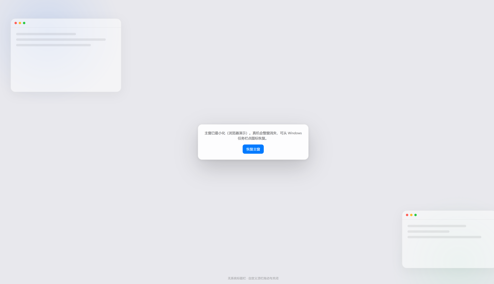

# 汇报

- 角色：前端
- 分支：`fe/hotfix-minimize-full-hide`
- 契约版本：0.3.2

## 给人看的产出

### 这一阶段交出了什么

顶栏「—」改成真正的**最小化**：一点之后整窗消失，不再留下一条 60px 顶栏杠。真机可从 Windows 任务栏点图标把完整主窗（左轨 + 日视图）叫回来。与「× 进托盘」分开。

### 打开窗口能看到什么

- 顶栏仍有「审 / — / ◌ / ⌃ / ×」；「—」的提示是「最小化」，不再在折叠/展开之间切换成 ▢
- 点「—」后：真机整窗进任务栏；浏览器演示里主窗消失，出现「已最小化」说明（不是 60px 杠）

### 点哪里、会发生什么

1. 点「—」→ `minimize()`（真机）/ 浏览器演示隐藏主窗；**不会**再 `set_main_collapsed` 留顶栏条。  
2. 任务栏点图标（真机）→ 系统恢复完整窗口。浏览器点「恢复主窗」同理。  
3. 「×」「◌」文案与逻辑本分支未改。

### 还没做什么

- 未改 × / 胶囊 / 置顶文案与二次关闭（留给另外 hotfix）
- 未做提醒 / 导出 / 开机自启

### 截图

最小化前：完整主窗（左轨 + 日视图），顶栏「—」为最小化。


点「—」后：主窗整窗消失，没有 60px 顶栏杠（浏览器演示卡片；真机为任务栏最小化）。



恢复后：左轨与日视图完整回来。


说明：截图在浏览器演示。真机用 Tauri `Window.minimize()` / 任务栏恢复；浏览器用独立 `minimized` 状态，避免与「× 托盘」提示文案混用。

## 改了哪些文件

- `src/api/window.ts`：`minimizeMain` / `unminimizeMain`（真机走 Tauri API，不新增命令）
- `src/api/mockWindow.ts`、`mockWindow.test.ts`：浏览器最小化演示与测试
- `src/components/shell/AppShell.tsx`：顶栏「—」接最小化；启动不再用 `mainCollapsed` 画 60px 杠
- `docs/reports/hotfix-minimize-full-hide/前端.md` 与截图

未手改 `src/bindings.ts`。未改 `package.json`。未改 × / 胶囊文案。

## 运行的命令和最后几行输出

```text
pnpm typecheck
# 通过

pnpm lint
# All matched files use Prettier code style!

pnpm test
# Test Files  9 passed (9)
# Tests  25 passed (25)

pnpm ownership
# ownership: fe 的 N 个文件都在允许范围内
```

## 没做完的部分

无。真机任务栏恢复依赖系统最小化行为，无需新后端命令。

## 需要人决定的问题

无。
