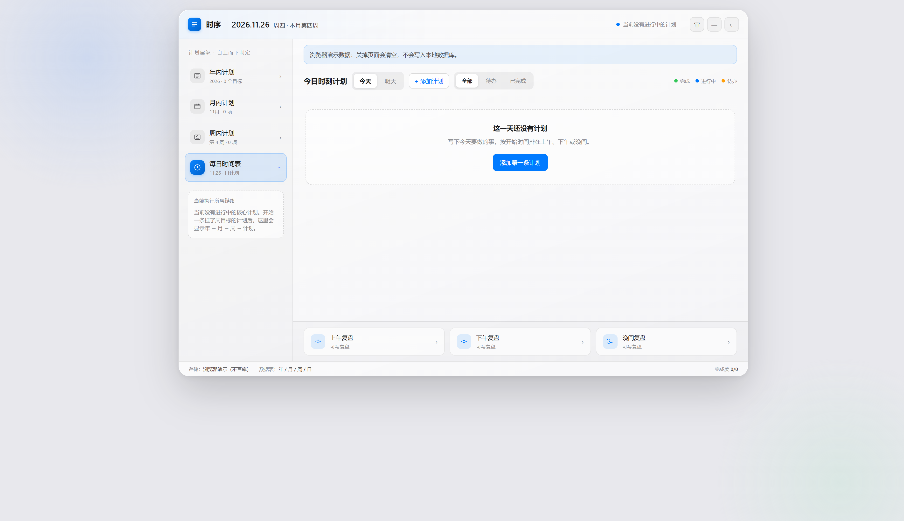
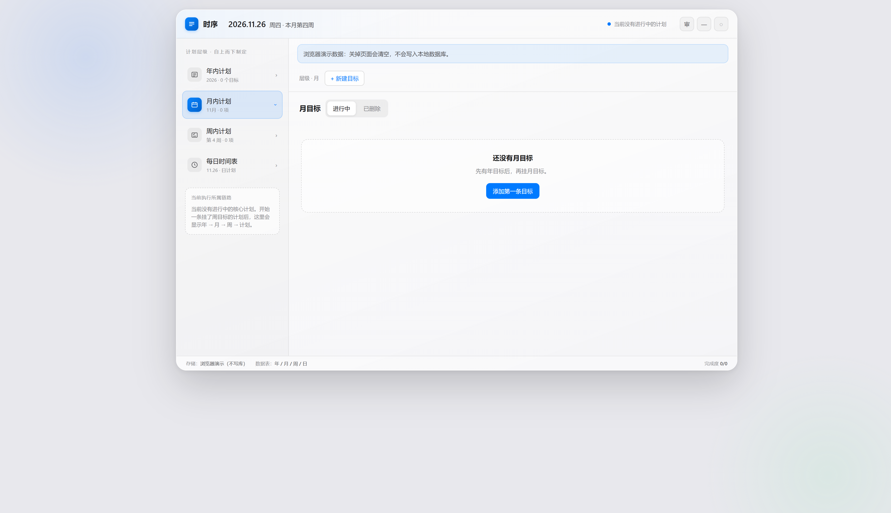
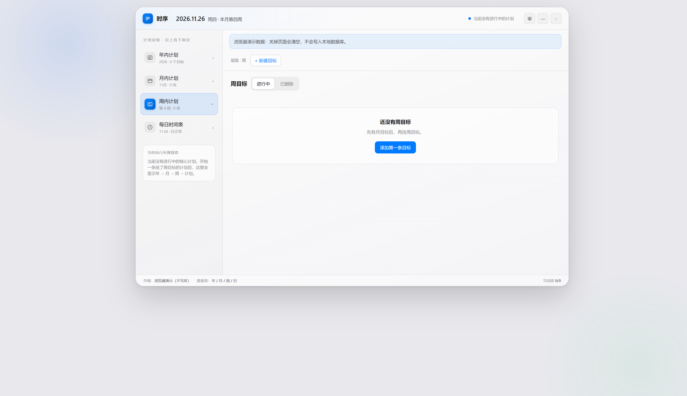
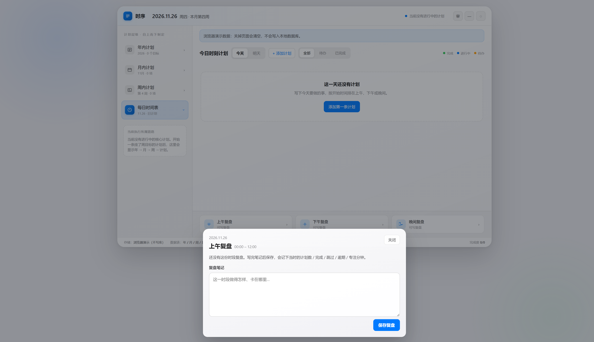

# 汇报

- 角色：前端
- 分支：`fe/layout-prototype-shell`
- 契约版本：0.2.3

## 给人看的产出

### 这一阶段交出了什么

主窗改成与原型一致的骨架：顶栏 + 左侧计划层级轨 + 右侧主区；看日计划时还有底栏三段复盘入口和底状态条。不再用整页顶上的「日计划 | 目标」两个 Tab 翻页——年 / 月 / 周 / 日都在左边点。计划完成/跳过、目标增删复盘、今天/明天、时段复盘与明天排程都还能用，只是换了壳。

### 打开窗口能看到什么

- 圆角玻璃主窗（不是整页白底）
- 顶栏：时序 Logo、日期与「周几 · 本月第几周」、正在执行、右侧审计/折叠/隐藏占位（点了只提示「下一切片再做」）
- 左轨：年内 / 月内 / 周内 / 每日；下方「当前执行所属链路」
- 右区：日时间轴，或对应层级的目标列表
- 日视图底：上午 / 下午 / 晚间复盘条 + 状态条（本地存储、完成度；没有云同步、没有收益分数）

### 点哪里、会发生什么

1. 左轨点「每日时间表」→ 右侧今日时刻计划，底栏可开复盘。
2. 左轨点「月内计划」或「周内计划」→ 右侧只看该层目标，可新建 / 写复盘 / 删除。
3. 点底栏「上午复盘」→ 打开复盘面板（无评分、无大模型）。
4. 主头「今天 / 明天」仍可切换核对排程。

### 还没做什么

- 真实置顶 / 托盘 / 胶囊、审计抽屉（顶栏只是占位）
- 复盘评分、大模型结论、云同步

### 截图

日视图整窗：顶栏 + 左轨 + 右时间轴 + 底复盘栏 + 状态条；顶栏没有「日计划 | 目标」Tab。



左轨点「月内计划」后，右侧是月目标区（层级筛选）。



左轨点「周内计划」后，右侧是周目标区。



从底栏打开上午复盘抽屉：只有笔记与统计说明，没有评分 / AI。



与改版前对比：以前是整页顶 Tab「日计划 | 目标」翻页；现在层级与日视图都在左轨切换，同一主窗内完成。

## 改了哪些文件

- `src/App.tsx`：改为挂载 `AppShell`
- `src/components/shell/*`：主窗、左轨、复盘底栏、状态条
- `src/components/DayView.*`：嵌主窗右区；复盘入口迁到底栏
- `src/components/GoalTree.*`：嵌主窗；按左轨层级过滤；去掉顶 Tab
- `src/lib/dateLabels.ts`：日期副标题
- `docs/reports/layout/前端.md` 与截图

未改 `src/bindings.ts`、契约、后端。

## 运行的命令和最后几行输出

```text
pnpm typecheck
# 通过

pnpm lint
# All matched files use Prettier code style!

pnpm test
# Test Files  6 passed (6)
# Tests  17 passed (17)

pnpm ownership
# ownership: fe 的 N 个文件都在允许范围内
```

## 没做完的部分

顶栏审计 / 折叠 / 隐藏仅为占位提示，不接系统窗口 API。

## 需要人决定的问题

无。
