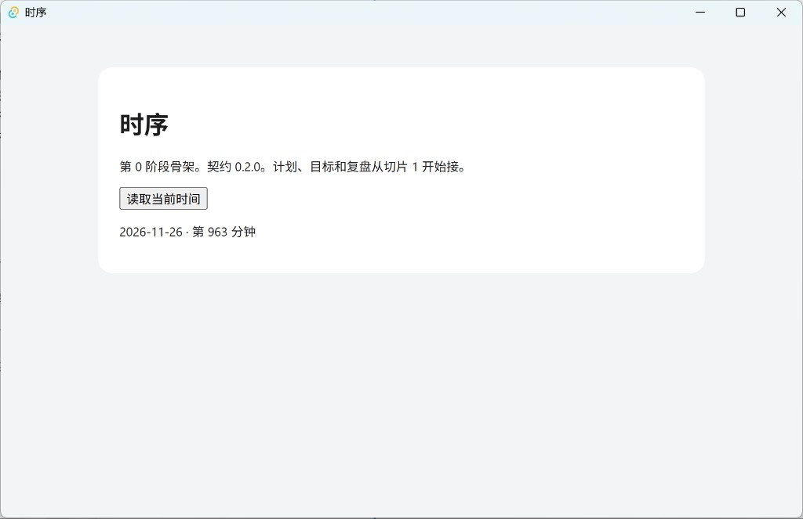

# 第 0 阶段产出说明

这一阶段先做出能打开的「时序」窗口，并确认它能读出今天的日期，以及从零点起的第几分钟。日计划、周目标、复盘都还没有。

## 打开窗口能看到什么

窗口标题是「时序」。中间是一块白卡片，上面有：

- 大标题「时序」
- 一行说明：「第 0 阶段骨架。契约 0.2.0。计划、目标和复盘从切片 1 开始接。」
- 一个按钮：「读取当前时间」
- 按钮下面一行结果，例如：「2026-11-26 · 第 963 分钟」

说明里的「契约 0.2.0」是这一阶段约定的版本号，不用操作它。「切片 1」就是下一阶段。

## 点哪里会发生什么

点「读取当前时间」。

按钮下面会显示两样东西：

- 当天日期，例如 2026-11-26
- 从当天零点算起的第几分钟，例如第 963 分钟

图里的 963，表示从那天零点起已经过了 963 分钟，大约是下午 4 点刚过。再点一次，会按当时的时间重新显示这一行。

## 还没做什么

现在还不能：

- 写当天的计划
- 写这一周的目标
- 做复盘

这些从下一阶段开始。现在的窗口只确认：程序能打开，也能读出今天和当前是第几分钟。
