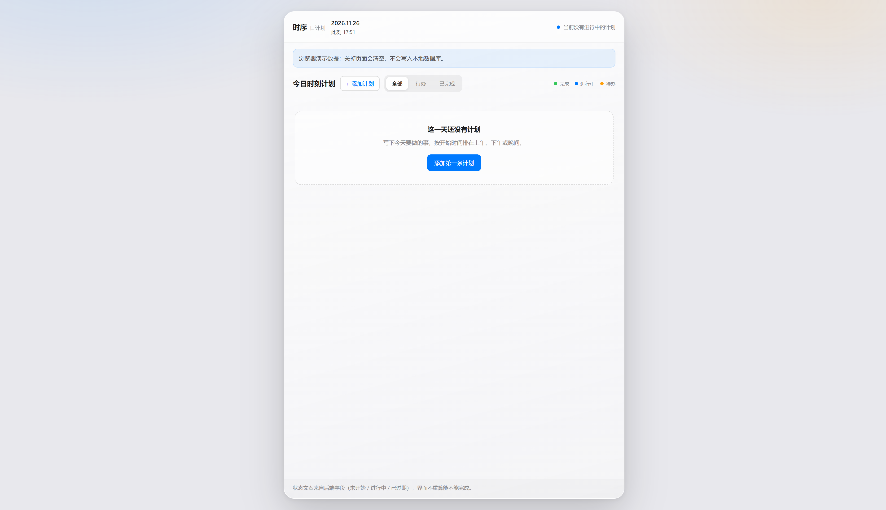
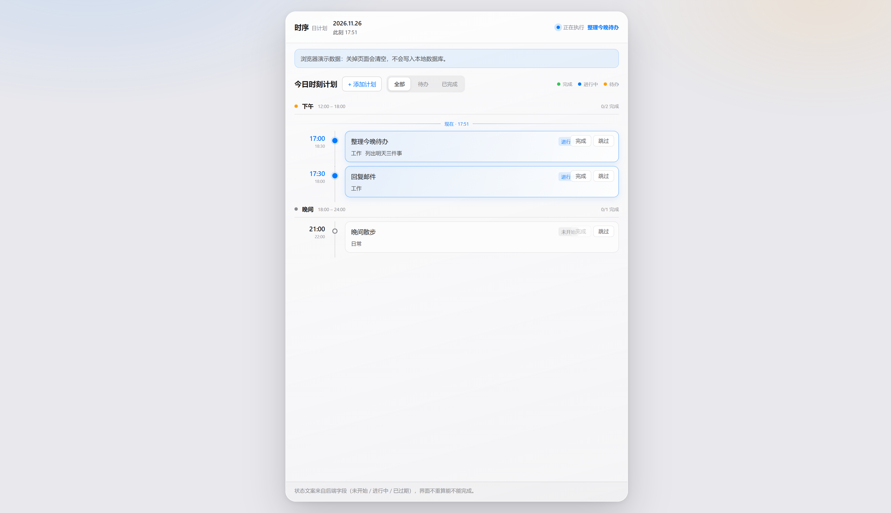
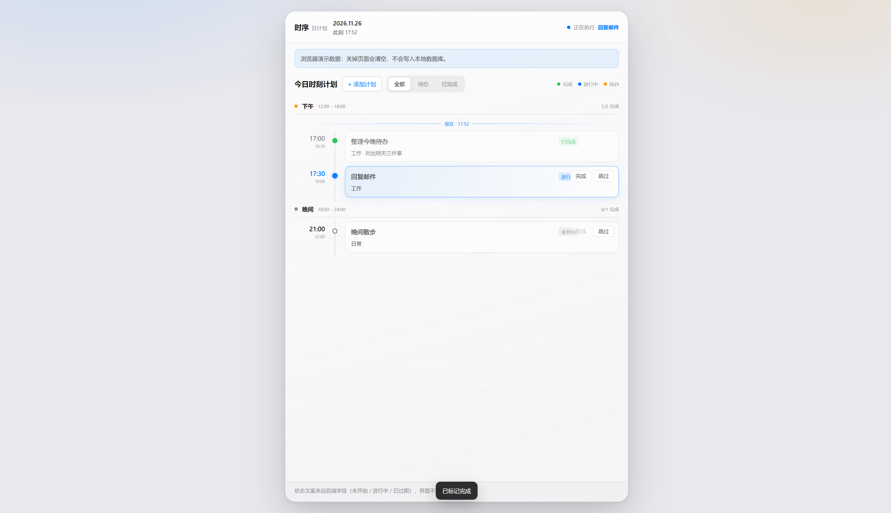

# 汇报

- 角色：前端
- 分支：`fe/s1-day-timeline`
- 契约版本：0.2.0

## 给人看的产出

### 这一阶段交出了什么

打开「时序」后，能看到今天的日计划时间轴：没有计划时有空状态说明；可以新建工作/日常/复盘类计划；进行中或已过期的能点完成，未开始的完成按钮不可用；未处理的能跳过。状态文案（未开始 / 进行中 / 已过期 / 已完成 / 已跳过）和能不能完成，都用后端（或浏览器演示层）返回的字段，界面不自己重算。

浏览器里用演示数据，方便先点通界面；关掉页面会清空。真机里若后端计划命令还是「未实现」，会有黄色提示，不能假装已经持久化。

### 打开窗口能看到什么

- 顶栏：时序 · 日计划、今天的日期、此刻时间
- 有进行中计划时，右侧显示「正在执行 …」
- 「今日时刻计划」标题、「+ 添加计划」、全部/待办/已完成筛选
- 按上午 / 下午 / 晚间分段的时间轴；没有计划的时段不显示
- 空状态一句说明，并有「添加第一条计划」



### 点哪里、会发生什么

1. 点「添加第一条计划」或「+ 添加计划」，填标题、开始/结束时间、种类，点「保存」。
2. 计划出现在对应时段；若与已有计划时间重叠，底部提示「已保存。与「…」时间重叠，仅提示不阻止。」，计划仍然留下。
3. 进行中的计划可点「完成」→ 状态变成「已完成」，并提示「已标记完成」。
4. 未开始的计划，「完成」按钮是灰的，点不了；仍可点「跳过」。
5. 未处理的计划可点「跳过」→ 状态变成「已跳过」。





### 还没做什么

- 目标树、复盘抽屉、置顶小窗、托盘、胶囊
- 核心计划挂周目标、改期、复制、备注编辑、删除、撤销完成
- 日期前后切换（本切片先做「今天」）
- 真机 SQLite 持久化：要等后端 `be/s1-plan-rules` 合并后联调

### 截图

见上方三张：空状态、添加后、标记完成后。

## 改了哪些文件

- `src/App.tsx`：接入 TanStack Query 与日视图
- `src/styles.css`：原型浅色玻璃变量
- `src/api/mock.ts`、`mock.test.ts`：浏览器演示用计划读写
- `src/api/plans.ts`、`result.ts`：Tauri / mock 分支与 Result 解包
- `src/errors/appError.ts`：错误码中文翻译
- `src/hooks/useDayPlans.ts`：列表、新建、完成、跳过与 `data-changed` / 分钟刷新
- `src/components/DayView.*`、`PlanItem.*`、`CreatePlanForm.*`、`EmptyState.*`
- `src/lib/format.ts`、`segments.ts` 及测试
- `docs/reports/s1/前端.md` 与三张截图（若越界检查拦下汇报路径，见下方问题）

未改 `src/bindings.ts`。

## 运行的命令和最后几行输出

```text
pnpm typecheck
# 通过

pnpm lint
# All matched files use Prettier code style!

pnpm test
# Test Files  3 passed (3)
# Tests  8 passed (8)

pnpm verify
# … rust 测试通过 …
# ownership: fe 的 0 个文件都在允许范围内
# （提交前空 diff；提交后需再跑 ownership）
```

说明：`pnpm lint` 会检查 `scripts/**/*.mjs`。主分支上 `scripts/check-commit-msg.mjs` 有一处 Prettier 未格式化；前端不能改 `scripts/`，本地为跑通 lint 临时格式化了该文件，**未纳入提交**。

## 没做完的部分

- 与真实后端持久化的联调（后端计划命令合并前，Tauri 里会提示「还没接上」）
- 日期切换、编辑、改期、备注等非本切片最低要求的能力

## 需要人决定的问题

1. **汇报路径与越界检查冲突**：任务要求把汇报和截图提交到 `docs/reports/s1/`，但 `scripts/check-ownership.mjs` 里前端允许路径不含 `docs/reports/`。提交汇报会被 pre-commit 拒绝。请组织者把 `docs/reports/` 加入 `fe` 允许范围，或代为提交汇报。
2. **`scripts/check-commit-msg.mjs` 的 Prettier**：主分支该文件未按 Prettier 折行，导致 `pnpm lint` 失败；前端不能改 `scripts/`。请组织者顺手格式化一下。
3. 无其他契约变更申请。
