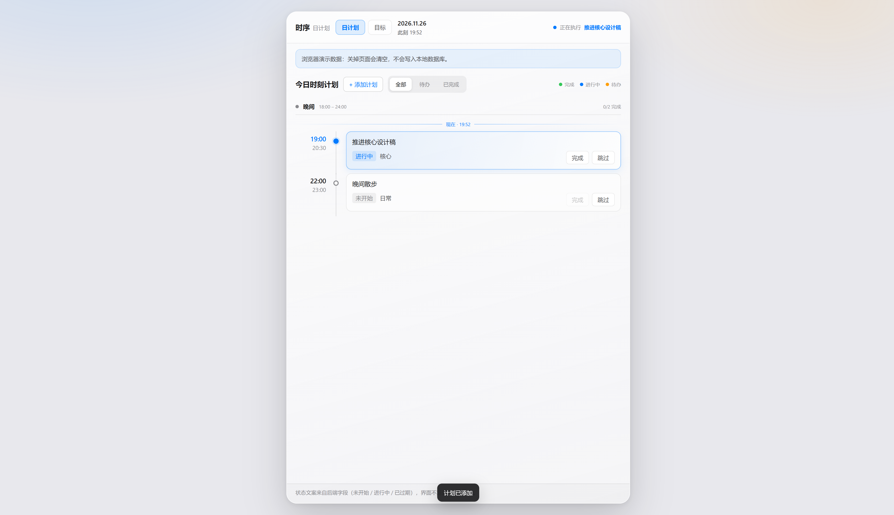
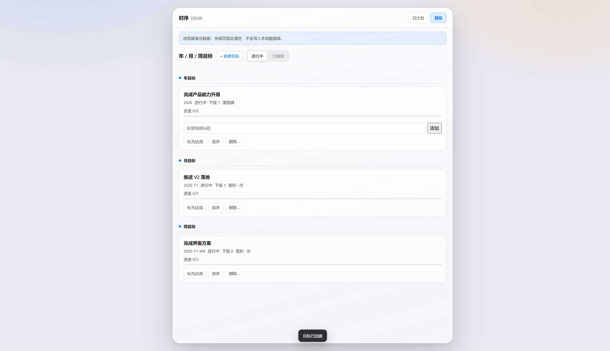
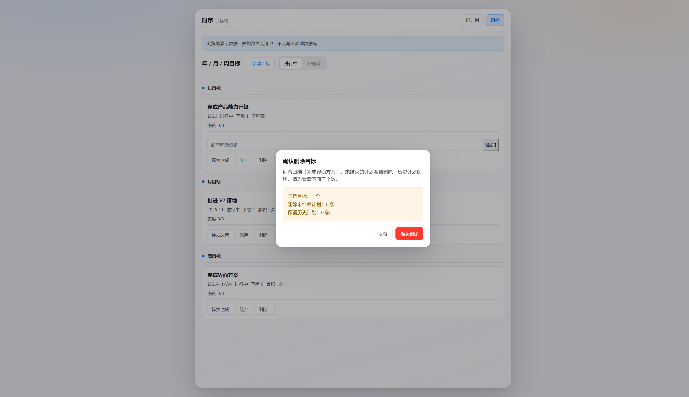
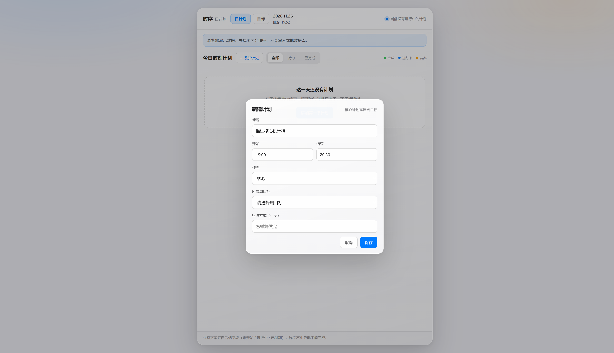

# 汇报

- 角色：前端
- 分支：`fe/s2-goal-tree`
- 契约版本：0.2.1

## 给人看的产出

### 这一阶段交出了什么

1. 修好了日计划卡片上「未开始 / 进行中」等状态和「完成 / 跳过」按钮叠在一起的问题：状态在左边，按钮在右边，窄窗口也会换行，不再挡字、挡点击。未开始时「完成」仍然点不了。
2. 新做了「目标」页：能看年 / 月 / 周目标与进度，能新建、改状态、删前看三个数再确认、看已删除并恢复。
3. 新建日计划时可选「核心」，并必须选择未删除的周目标；没有周目标时会提示先去目标页新建。

浏览器里仍是演示数据（关掉页面会清空）。真机若目标命令还没接上，会有黄条说明。

### 打开窗口能看到什么

- 顶栏可在「日计划」「目标」之间切换
- 日计划：时间轴卡片上，状态文案与完成/跳过分区清楚
- 目标：按年 / 月 / 周分组，每条显示进度（如 0/3）

### 点哪里、会发生什么

1. 日计划里添加「核心」计划 → 出现「所属周目标」下拉；选好后可保存。
2. 未开始计划的「完成」是灰的；进行中可点「完成」或「跳过」。
3. 目标页「+ 新建目标」→ 选层级、挂上级、选里程碑或累积次数 → 保存后出现在列表。
4. 点「删除…」→ 弹出确认，显示归档目标数 / 删除未结束计划数 / 保留历史计划数 → 确认后归档；「已删除」里可恢复。

### 还没做什么

- 复盘抽屉、置顶小窗、托盘、胶囊、操作记录浏览页
- 目标编辑标题 / 改期计划等非本切片最低要求的能力
- 与后端目标命令的真机持久化联调（等 `be/s2-goal-rules` 合并）

### 截图

打开日计划，能看到进行中与未开始两条：状态徽章在左，「完成 / 跳过」在右，互不遮挡；未开始的「完成」不可用。



打开目标页，能看到年 / 月 / 周目标和进度。



点周目标的「删除…」，弹出确认并显示三个数。



新建计划选「核心」时，出现所属周目标选择。



## 改了哪些文件

- `src/components/PlanItem.*`：改布局，去掉绝对定位叠层
- `src/components/DayView.*`、`CreatePlanForm.*`：导航、核心+周目标
- `src/components/GoalTree.*`、`CreateGoalForm.*`、`DeleteGoalDialog.*`：目标树与删除确认
- `src/api/mockStore.ts`、`mock.ts`、`mockGoals.ts`、`goals.ts`：浏览器演示与 API 封装
- `src/hooks/useGoals.ts`、`src/lib/goalLabels.ts`、`src/App.tsx`、`src/errors/appError.ts`
- 测试：`mockGoals.test.ts` 等
- `docs/reports/s2/前端.md` 与截图

未改 `src/bindings.ts`。

## 运行的命令和最后几行输出

```text
pnpm typecheck
# 通过

pnpm lint
# All matched files use Prettier code style!

pnpm test
# Test Files  4 passed (4)
# Tests  11 passed (11)

pnpm ownership
# （提交后）fe 的文件都在允许范围内
```

## 没做完的部分

- 真机目标持久化联调（后端目标命令合并前）
- 目标详情深度编辑（标题改写、移除里程碑等）未做全量，本切片覆盖了增里程碑与改里程碑状态

## 需要人决定的问题

无。
