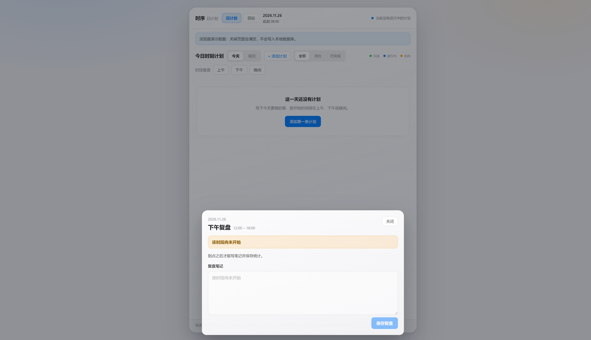
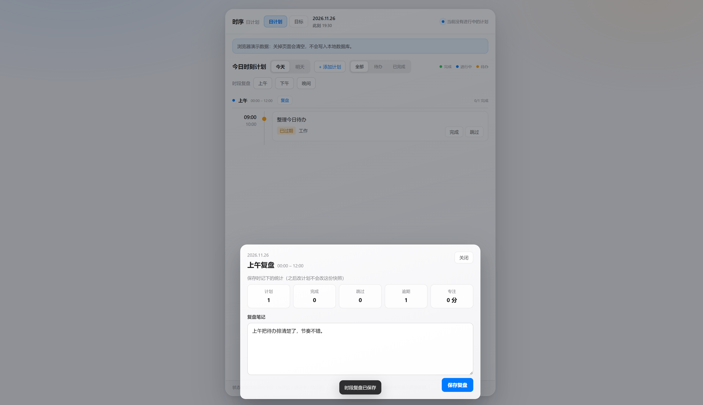
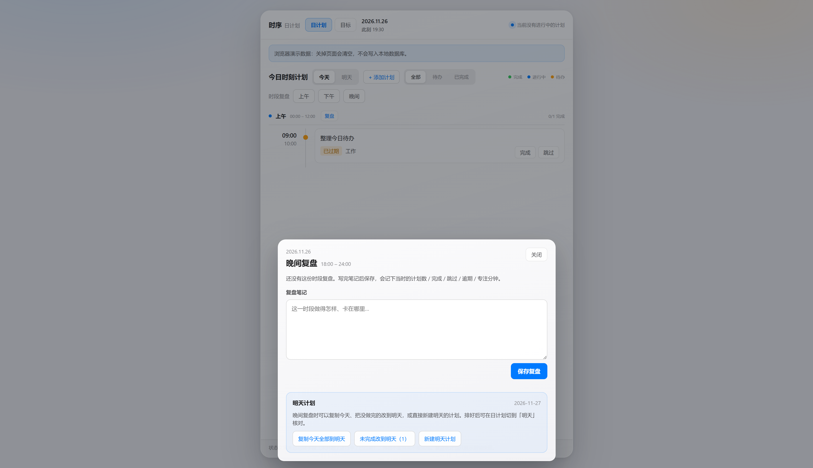
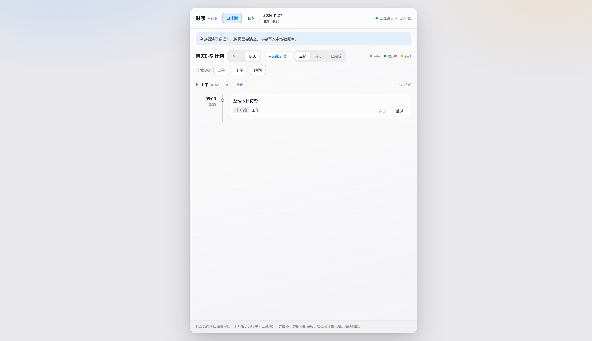

# 汇报

- 角色：前端
- 分支：`fe/s3-review-tomorrow`
- 契约版本：0.2.2

## 给人看的产出

### 这一阶段交出了什么

日计划上可以进上午 / 下午 / 晚间复盘：写笔记、保存后看到当时记下的统计（计划数、完成、跳过、逾期、专注分钟）。没到点的时段会明确写「该时段尚未开始」，不能假装已保存。晚间复盘底下有「明天计划」区：复制今天、把未完成改到明天、新建明天计划。日计划顶上可在「今天 / 明天」之间切换，用来核对排好的明天。目标页每条目标可以「写复盘」，可多篇，新的在前。没有做复盘评分和大模型结论。

浏览器仍是演示数据（关掉会清空）。统计只展示后端（或演示 mock）返回的快照，界面不重算。

### 打开窗口能看到什么

- 日计划：今天 / 明天切换；「时段复盘」三个按钮；各时段旁也有「复盘」
- 复盘抽屉：笔记、保存时的五项统计；未到点时的橙色提示
- 晚间复盘底部：明天计划区三个操作
- 目标页：每条目标有「写复盘」

### 点哪里、会发生什么

1. 点「下午」复盘（早上八点演示时钟）→ 看到「该时段尚未开始」，笔记与保存不可用。
2. 点「上午」复盘 → 写笔记 →「保存复盘」→ 出现五项统计与 toast「时段复盘已保存」；再打开仍是上次内容和统计。
3. 点「晚间」→ 底部明天计划区 →「复制今天全部到明天」→ 关掉后点「明天」→ 能看到复制过去的计划。
4. 目标页点「写复盘」→ 可新写多篇；历史列表新的在前，每篇带保存时统计。

### 还没做什么

- 复盘评分、大模型结论、置信度
- 置顶小窗、托盘、胶囊、操作记录浏览页
- 与后端复盘 / 复制改期命令的真机持久化联调（等后端切片合并）

### 截图

打开下午复盘（演示时钟 08:00）：橙色提示「该时段尚未开始」，保存不可用。



保存上午复盘后：笔记还在，并显示保存时的五项统计。



打开晚间复盘：底部有明天计划区（复制 / 改期 / 新建）。



复制今天后切到「明天」：能看到排好的计划。



## 改了哪些文件

- `src/components/DayView.*`：今天/明天切换、时段复盘入口
- `src/components/SegmentReviewPanel.*`、`TomorrowPlanZone.*`、`ReviewStatsBlock.*`：时段复盘与明天计划区
- `src/components/GoalReviewPanel.*`、`GoalTree.tsx`：目标复盘
- `src/api/reviews.ts`、`mockReviews.ts`；`plans.ts` 增加 copy / reschedule；`mock.ts` / `mockStore.ts`
- `src/hooks/useDayPlans.ts`：按日期加载；复制与改期
- `src/lib/dates.ts`、`segments.ts`、`planFields.ts`、`errors/appError.ts`
- 测试：`mockReviews.test.ts`、`segments.test.ts`
- `docs/reports/s3/前端.md` 与截图

未改 `src/bindings.ts`。

## 运行的命令和最后几行输出

```text
pnpm typecheck
# 通过

pnpm lint
# All matched files use Prettier code style!

pnpm test
# Test Files  6 passed (6)
# Tests  17 passed (17)

pnpm ownership
# ownership: fe 的 N 个文件都在允许范围内
```

## 没做完的部分

真机 Tauri 若复盘命令仍返回「未实现」，会走黄条提示；浏览器演示可完整点通。

## 需要人决定的问题

无。
