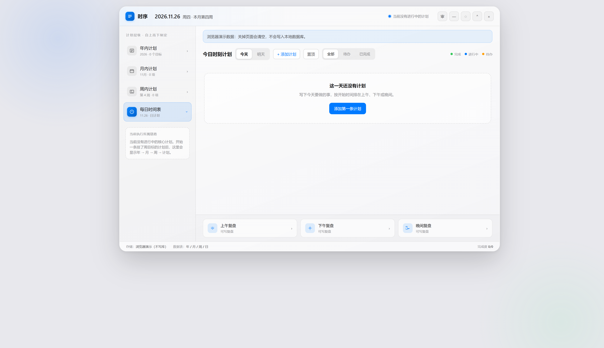
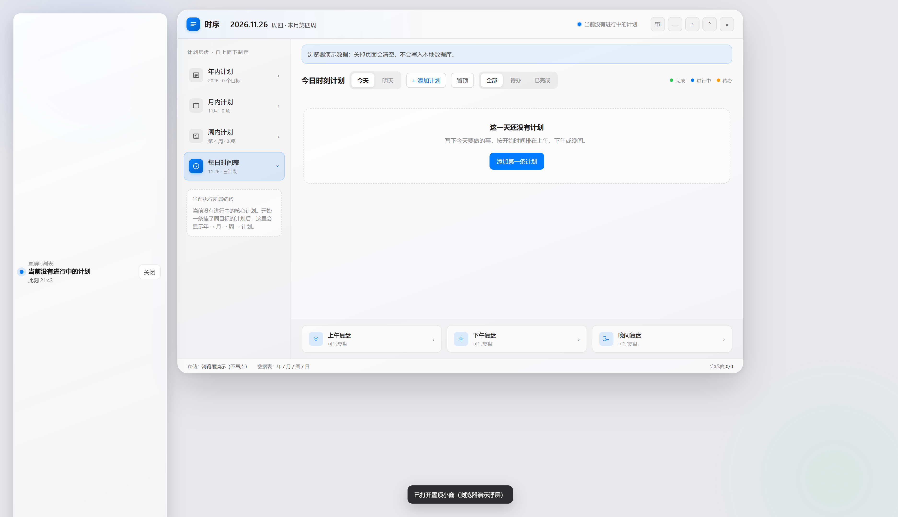
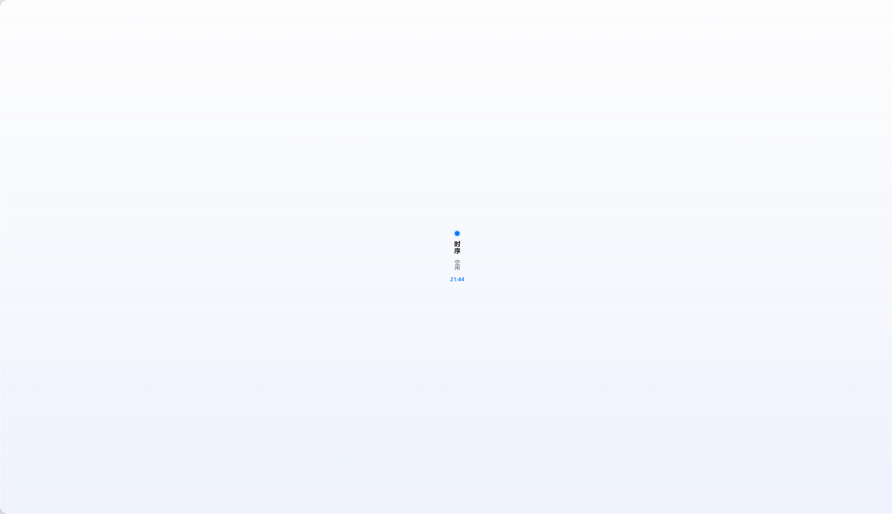
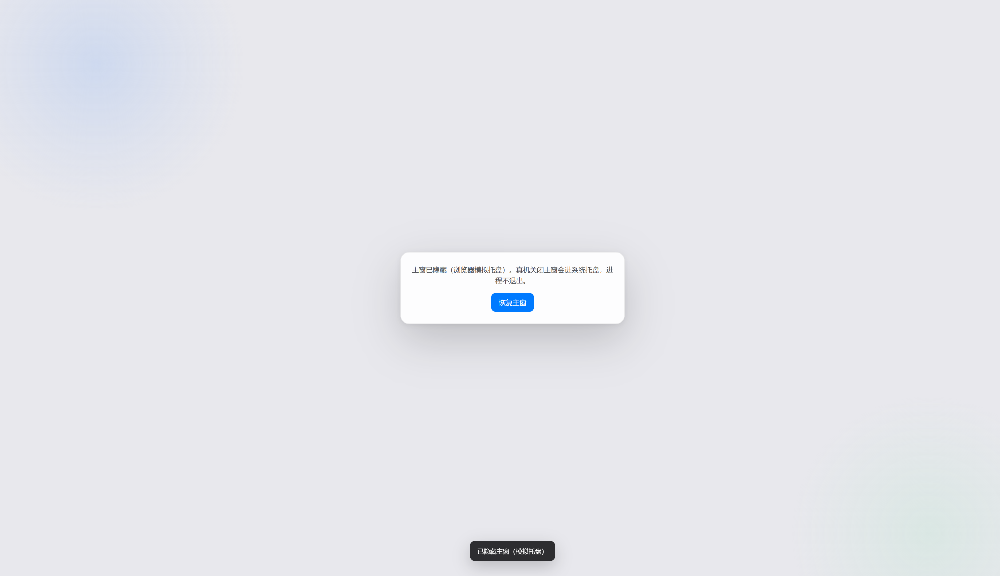

# 汇报

- 角色：前端
- 分支：`fe/s4-window-shell`
- 契约版本：0.3.0

## 给人看的产出

### 这一阶段交出了什么

在现有左轨主窗上，把顶栏占位接成窗口能力：折叠、隐藏到胶囊、打开置顶小窗、关闭进托盘（真机）、拖动时通知后端、读写窗口布局。并为置顶小窗 / 边缘胶囊做了精简界面（显示进行中计划或空闲 + 此刻时间）。没有做完整审计页、开机自启、评分。

浏览器里用演示模拟（关掉页面会清空）；若后端窗口命令仍返回「未实现」，会自动落到同一套演示逻辑，方便联调前点通。

### 打开窗口能看到什么

- 主窗仍是：顶栏 + 左轨 + 右主区 +（日视图）底复盘栏 + 状态条
- 顶栏按钮：审（仍提示下一切片）/ 折叠 / 隐藏到胶囊 / 置顶 / 关闭到托盘
- 日视图主头有「置顶」
- 置顶小窗：窄条，正在执行 + 此刻时间 + 关闭
- 胶囊：贴边竖条，短状态 + 时间；点击恢复主窗

### 点哪里、会发生什么

1. 顶栏「—」→ 折叠主内容；再点展开。
2. 「◌」→ `show_capsule` + `hide_main_to_tray`（浏览器：主窗隐藏 + 右侧胶囊）。
3. 「⌃」或日视图「置顶」→ `show_pin`（浏览器：左上角浮层置顶条）。
4. 「×」或系统关闭（真机拦截）→ `hide_main_to_tray`，进程不退出。
5. 拖动顶栏 → `set_dragging(true/false)`；真机还会 `startDragging`。
6. 启动读 `get_window_layout`；真机移动/缩放结束防抖 `save_window_layout`。

### 还没做什么

- 操作记录完整浏览页（切片 5）
- 开机自启、提醒、评分、云同步
- 真机托盘菜单「打开 / 退出」由后端实现；前端只接线命令

### 截图

主窗（左轨布局保留，无整页 Tab）。



置顶小窗浮在主窗旁（浏览器演示浮层；真机为独立 alwaysOnTop 窗）。



边缘胶囊精简界面（`?window=capsule` / 真机 capsule 标签窗）。



关闭主窗后：浏览器模拟托盘说明；真机应留在系统托盘、进程不退出。



说明：截图在浏览器演示环境下拍摄。真机需后端 `be/s4-window-tray` 创建 `pin`/`capsule` 窗并实现托盘后，用同一套前端命令点通。

## 改了哪些文件

- `src/api/window.ts`、`mockWindow.ts`：窗口命令封装与浏览器 mock
- `src/components/shell/AppShell.*`：折叠 / 隐藏 / 置顶 / 托盘 / 拖动 / 布局
- `src/components/windows/PinWindow.*`、`CapsuleWindow.*`：精简界面
- `src/App.tsx`：按窗口角色路由（main / pin / capsule）
- `src/hooks/useActiveNow.ts`、`src/lib/windowRole.ts`
- `src/components/DayView.*`：置顶入口
- 测试：`mockWindow.test.ts`
- `docs/reports/s4/前端.md` 与截图

未手改 `src/bindings.ts`。

## 运行的命令和最后几行输出

```text
pnpm typecheck
# 通过

pnpm lint
# All matched files use Prettier code style!

pnpm test
# Test Files  7 passed (7)
# Tests  20 passed (20)

pnpm ownership
# ownership: fe 的 N 个文件都在允许范围内
```

## 没做完的部分

真机 alwaysOnTop 置顶窗、系统托盘图标与「退出」菜单依赖后端切片；前端已按契约命令接线，未实现时自动降级为浏览器演示。

## 需要人决定的问题

无。隐藏到边缘时前端约定为：先 `show_capsule` 再 `hide_main_to_tray`（与任务包一致）。
