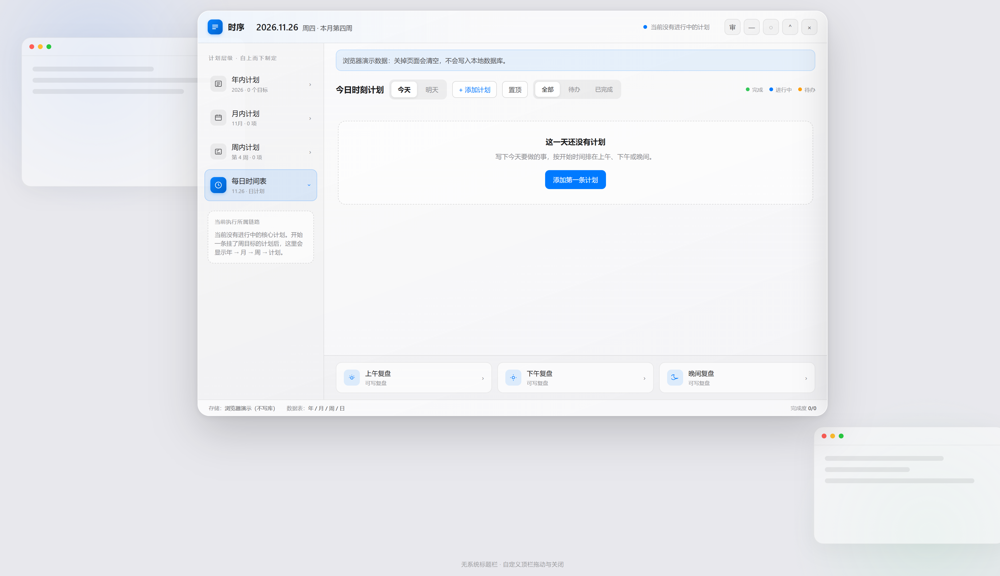
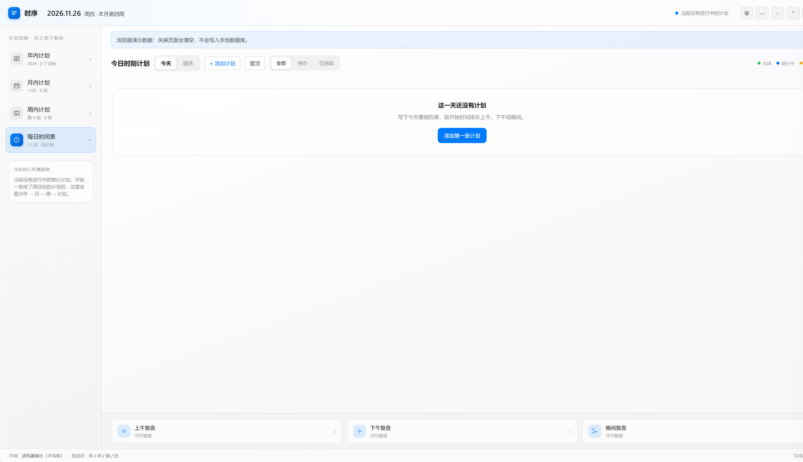

# 汇报

- 角色：前端
- 分支：`fe/s5-remove-fake-desktop`
- 契约版本：0.3.1

## 给人看的产出

### 这一阶段交出了什么

修了切片 5 合入后真机窗口里那块「背景板」。以前打开软件，外面还有一层灰色桌面、光晕、两扇假窗，真正的界面缩成中间一张圆角卡片，看起来像网页演示套在窗口里。现在 **Tauri 真机窗口就是软件本身**：界面铺满整个窗口，不再露出外面那层假桌面。

浏览器里打开演示页时，仍保留假桌面，方便对照「无边框悬浮窗」的观感。

### 打开窗口能看到什么

**真机（Tauri）**

- 一打开就是时序主界面：自定义顶栏、左轨、今日计划，铺满窗口
- 没有灰色垫色、没有光晕、没有半透明假窗、没有底部「无系统标题栏…」那行字
- 顶栏仍是「时序 / 日期 / 审 / 折叠 / 胶囊 / 置顶 / ×」
- 可保留很轻的圆角，但四角不会再漏出一块「背景板」

**浏览器演示**

- 仍能看到浅灰桌面、两扇假窗、底部提示，主界面是中间的圆角玻璃窗（只给网页演示用）

### 点哪里、会发生什么

这一阶段没有新按钮。点顶栏、左轨、计划、操作记录的行为与切片 5 相同。

用户能感受到的变化：真机里不再是「一块背景板套着软件」，窗口边缘就是主界面边缘。

### 还没做什么

- 没有改操作记录、托盘、胶囊、置顶小窗的功能
- 没有做开机自启、提醒、评分、云同步
- 未改窗口透明或系统级圆角（那是窗口配置，不在本次前端范围）

### 截图

打开浏览器演示页：外面仍是假桌面，中间是时序圆角窗，底部有「无系统标题栏 · 自定义顶栏拖动与关闭」。这是网页演示用的，真机不会这样。



真机路径（`isTauri()`）：假窗、光晕、桌面提示都去掉，主界面铺满窗口，没有居中卡片，也没有大块外层底色。点的是「打开窗口」这一步，结果就是铺满，画面不再变成另一张。



## 改了哪些文件

- `src/components/shell/AppShell.tsx`：用 `isTauri()` 分支；真机不渲染假桌面 DOM
- `src/components/shell/AppShell.module.css`：真机 `.app` 宽高 100%、无外层 padding；浏览器保留演示桌面
- `src/styles.css`：真机下 html/body/#root 铺满，底色与主界面衔接，避免圆角外漏灰板
- `docs/reports/s5/前端-去假桌面.md` 与截图

未手改 `src/bindings.ts`。未改 `package.json`。

## 运行的命令和最后几行输出

```text
pnpm typecheck
# 通过（无输出）

pnpm lint
Checking formatting...
All matched files use Prettier code style!

pnpm test
 Test Files  8 passed (8)
      Tests  21 passed (21)
   Duration  799ms

pnpm ownership
ownership: fe 的 6 个文件都在允许范围内
```

## 没做完的部分

无。真机假桌面已按 `isTauri()` 去掉；浏览器演示桌面保留。

## 需要人决定的问题

无。
