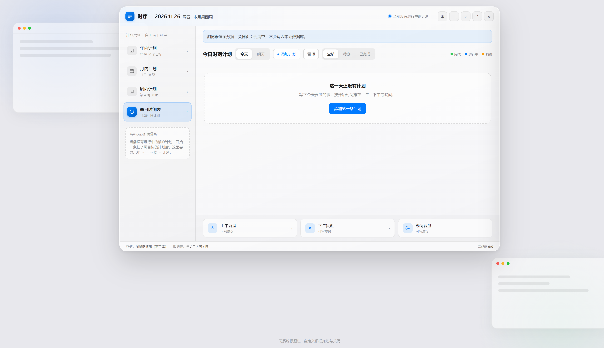
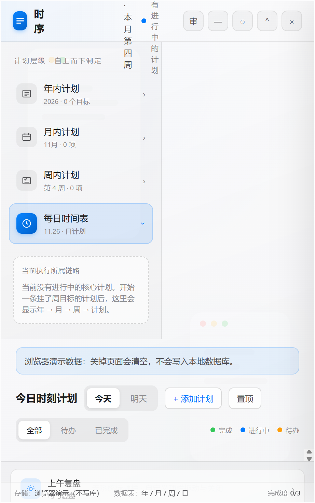
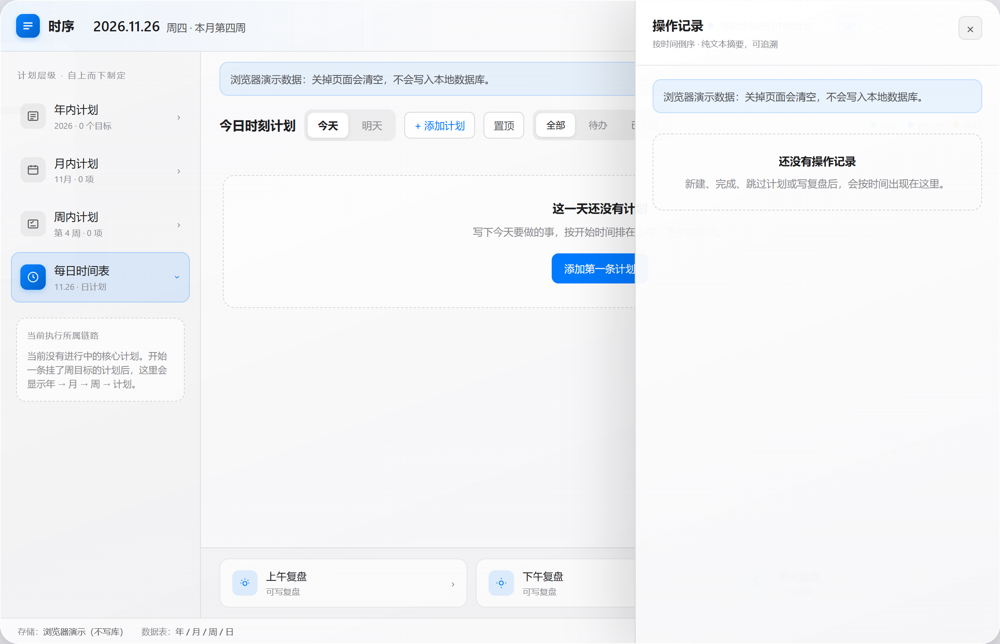

# 汇报

- 角色：前端
- 分支：`fe/s5-audit-frameless`
- 契约版本：0.3.0

## 给人看的产出

### 这一阶段交出了什么

主窗看起来更像原型里的「无边框悬浮窗」：背景上能看见别的假窗口，时序自己是圆角玻璃窗，没有套在系统标题栏里。顶栏「审」打开操作记录抽屉，能按时间倒序看动作、对象名和纯文本摘要，还能「加载更早」。点计划类记录可关掉抽屉、切回日视图并高亮约 1.8 秒。

浏览器里操作记录是演示数据（关掉页面会清空），界面上有标明。真机走 `list_audit`；若后端仍返回未实现，会暂时落到同一套演示列表，方便联调。

### 打开窗口能看到什么

- 桌面背景 + 两扇半透明假窗 + 底部提示「无系统标题栏 · 自定义顶栏拖动与关闭」
- 时序主窗：圆角、阴影、自定义顶栏（拖动区）+「审 / 折叠 / 胶囊 / 置顶 / ×」
- 左轨 + 日视图骨架不变
- 「审」打开后：右侧「操作记录」抽屉；空状态有一句说明；有记录时每条显示时间、动作·对象类型、标题、摘要

### 点哪里、会发生什么

1. 拖动顶栏空白处 → 真机拖动主窗；浏览器只做视觉反馈。
2. 顶栏「审」→ 打开/收起操作记录；折叠时会先展开主窗。
3. 抽屉「×」或再点「审」→ 收起。
4. 「加载更早」→ 用上一条 id 作 `beforeId` 继续翻；没有更多时显示「没有更早的记录了」。
5. 「转到日计划并高亮」→ 关抽屉、切到日视图，对应计划描边高亮约 1.8 秒。
6. 「×」→ 仍走关闭到托盘（与切片 4 一致）。

### 还没做什么

- 开机自启、提醒、评分、云同步
- 目标 / 复盘类记录的跳转高亮（本切片只做了计划）
- 真机无边框由后端 `decorations: false` 落地；本分支用浏览器桌面背景证明自定义顶栏是唯一拖动/关闭入口
- 未做独立最大化按钮（可用系统/Tauri 能力时再补）

### 截图

打开窗口：圆角主窗浮在假桌面上，没有系统标题栏套框；顶栏有「审」和关闭。



有几条日计划时的无边框观感（仍无系统框）。



点「审」后空状态：还没有操作记录时的说明。



写入/演示记录后：列表可见时间、动作、对象名、摘要，以及跳转按钮。


滚到底点「加载更早」后：显示「没有更早的记录了（共 25 条）」。


说明：截图在浏览器演示环境下拍摄。真机需后端去掉系统边框并实现 `list_audit` 后，用同一套界面点通。

## 改了哪些文件

- `src/api/audit.ts`、`mockAudit.ts`、`mockAudit.test.ts`：`list_audit` 封装、浏览器 mock、翻页测试
- `src/api/mockStore.ts`、`mock.ts`、`mockGoals.ts`、`mockReviews.ts`：演示环境写入操作记录
- `src/lib/auditLabels.ts`：动作/实体中文标签与时间排版
- `src/components/shell/AuditDrawer.*`：操作记录抽屉
- `src/components/shell/AppShell.*`：顶栏「审」、假桌面无边框观感、跳转高亮状态
- `src/components/DayView.*`：计划高亮样式
- `docs/reports/s5/前端.md` 与截图

未手改 `src/bindings.ts`。未改 `package.json`。

## 运行的命令和最后几行输出

```text
pnpm typecheck
# 通过

pnpm lint
# All matched files use Prettier code style!

pnpm test
# Test Files  8 passed (8)
# Tests  21 passed (21)

pnpm ownership
# ownership: fe 的 N 个文件都在允许范围内
```

## 没做完的部分

- 目标、复盘记录的跳转与高亮
- 真机无边框与真实 `list_audit` 依赖后端合入后验收

## 需要人决定的问题

无。
