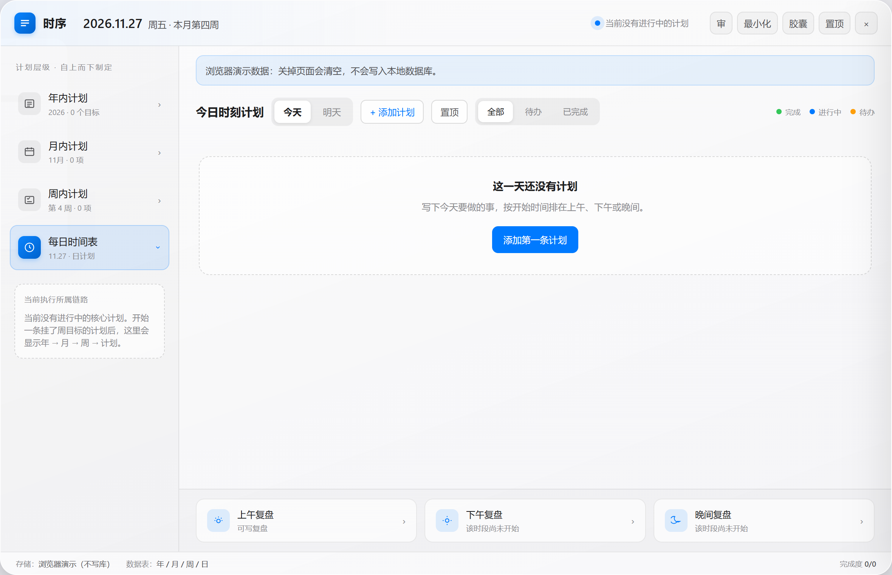
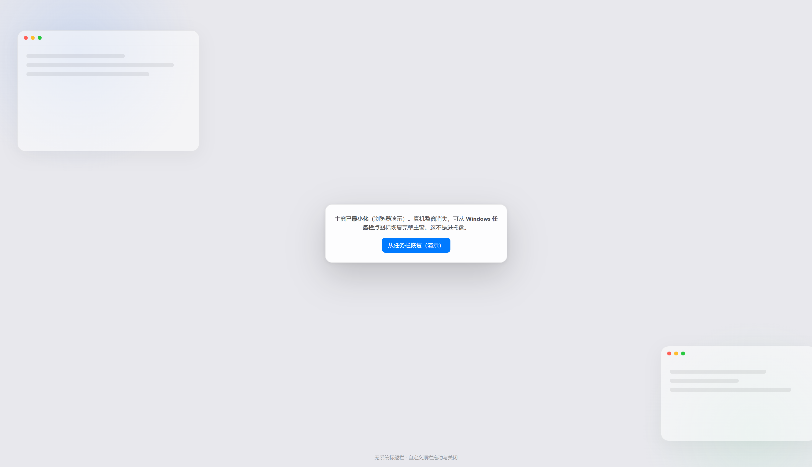
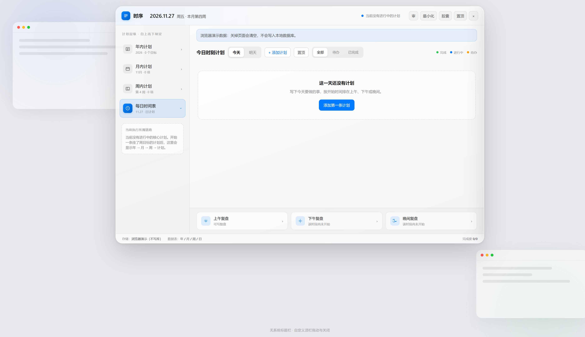
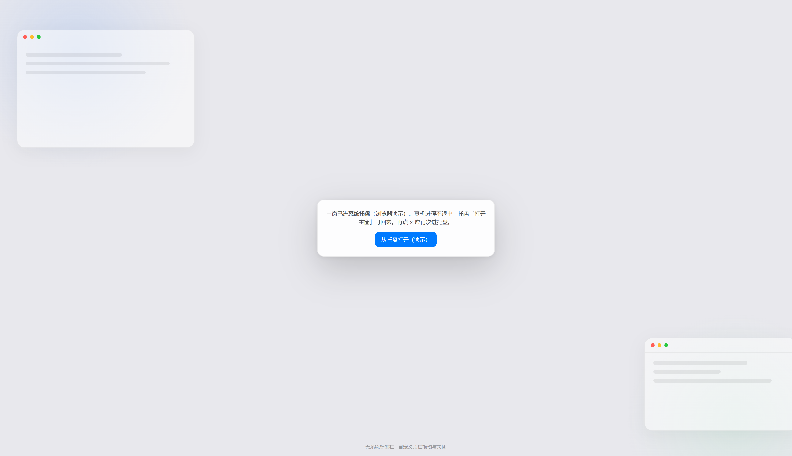

# 汇报

- 角色：前端
- 分支：`fe/window-min-close`
- 契约版本：0.3.2

## 给人看的产出

### 这一阶段交出了什么

把「最小化」和「× 进托盘」收成正式、分得清的两条路：

1. **最小化**：整窗消失；真机从任务栏恢复完整主窗（左轨+主区）；不是留顶栏杠，也不是进托盘。  
2. **×**：进系统托盘；托盘打开后再 × 仍有效；成功/失败有短提示。  
3. 顶栏保持：`审` / `最小化` / `胶囊` / `置顶` / `×`。  
4. 浏览器演示里两套文案和按钮分开，不会混成一种。

并去掉前端与后端抢着关窗的双重 hide：系统关闭只交给 Rust；应用内 × 只调 `hide_main_to_tray`。

### 打开窗口能看到什么

顶栏短中文按钮。点「最小化」与点「×」在演示页会看到**不同说明卡片**（任务栏恢复 vs 托盘打开）。

### 点哪里、会发生什么

1. 「最小化」→ 整窗没了；演示页写明「这不是进托盘」；「从任务栏恢复（演示）」回来是完整窗。  
2. 「×」→ 进托盘；「从托盘打开（演示）」回来；再 × 再次进托盘。  
3. 真机系统关闭：由后端 `CloseRequested` → `hide_main_to_tray`（前端不再挂一层 onCloseRequested）。

### 还没做什么

- 提醒 / 导出 / 开机自启  
- 未等后端 `minimize_main` 合入（见下方切换说明）

### 截图

最小化前完整窗（含可读顶栏文案）。



最小化后（演示说明：任务栏恢复，不是托盘）。



从任务栏恢复后完整窗。



× 第一次进托盘。


打开后再 ×，第二次仍进托盘。



说明：截图为浏览器演示。真机最小化靠任务栏；托盘靠系统托盘图标 /「打开主窗」。

### 后端未合入时如何接、合入后如何切换

| 能力 | 当前（本分支） | 后端合入后 |
| --- | --- | --- |
| 最小化 | 真机 `getCurrentWindow().minimize()`；浏览器 mock | `bindings` 有 `minimizeMain` 后，把 `minimizeMain()` 改成 `unwrapResult(await commands.minimizeMain())`（`src/api/window.ts` 已留注释） |
| 关闭进托盘 | 只调 `commands.hideMainToTray`（`closeMainToTray` 薄封装） | 继续同一命令；依赖后端 hide/show 可重复与 `show_main` 能解除最小化 |
| 系统关闭 | **仅 Rust** `CloseRequested` | 保持只留后端一层；前端不再双重 hide |

## 改了哪些文件

- `src/api/window.ts`：去掉二次 `win.hide()` 兜底；`closeMainToTray` 只走后端命令；最小化切换注释  
- `src/components/shell/AppShell.tsx`：去掉前端 `onCloseRequested`；最小化/托盘演示文案与按钮分开；成功/失败 toast  
- `docs/reports/window-min-close/前端.md` 与截图

未手改 `src/bindings.ts`。未改 `package.json`。

## 运行的命令和最后几行输出

```text
pnpm typecheck
# 通过

pnpm lint
# All matched files use Prettier code style!

pnpm test
# Test Files  9 passed (9)
# Tests  26 passed (26)

pnpm ownership
# ownership: fe 的 N 个文件都在允许范围内
```

## 没做完的部分

等 `be/window-min-close` 合入后，把最小化切到 `commands.minimizeMain`（一行级切换）。

## 需要人决定的问题

无。
